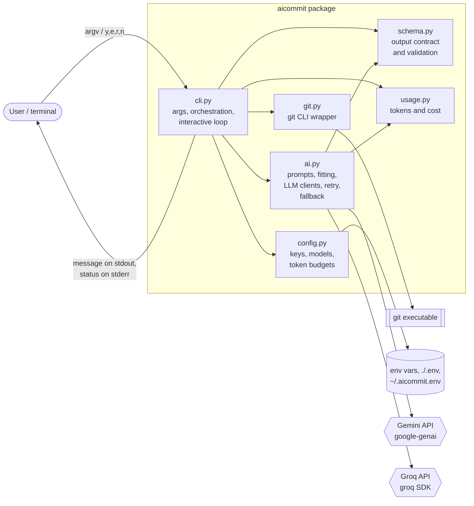
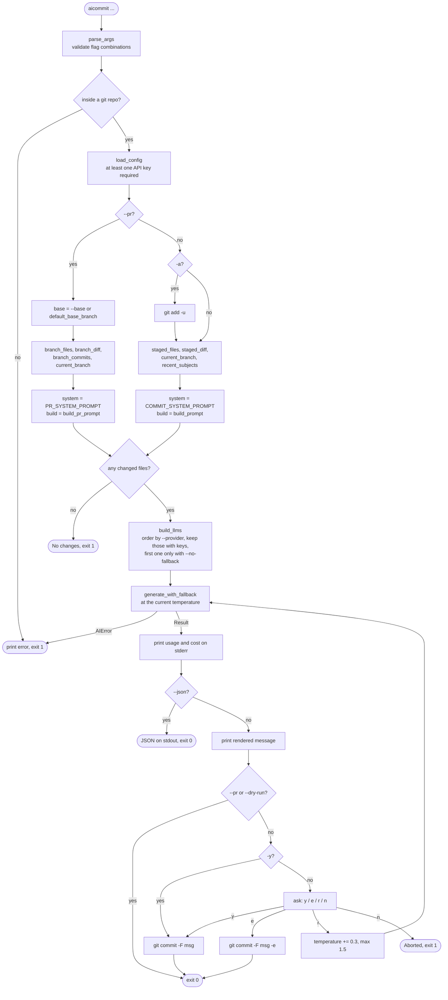
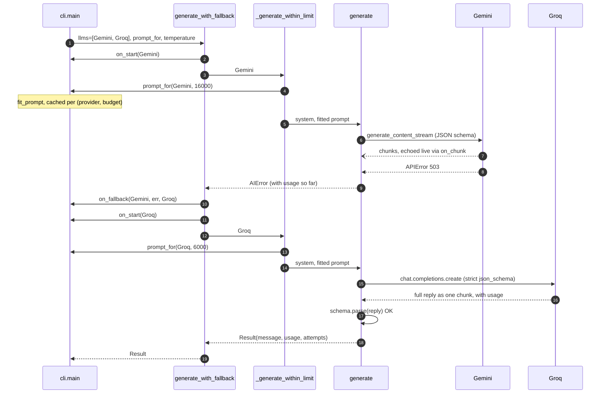
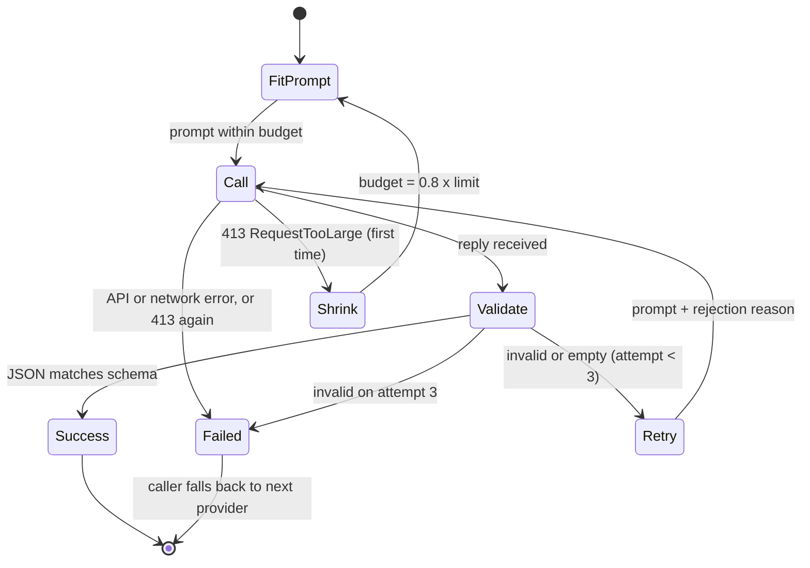
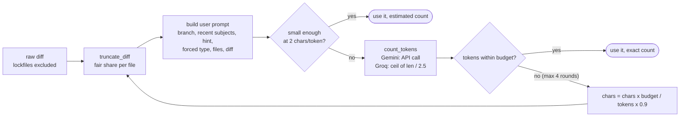

# aicommit: Architecture

This document describes how `aicommit` is put together: the components, how data flows between them,
and the core algorithms in pseudocode. For a function-by-function walkthrough, see
[CODE_GUIDE.md](CODE_GUIDE.md). For setup and usage, see [README.md](README.md) and [USAGE.md](USAGE.md).

Diagrams use [Mermaid](https://mermaid.js.org/), which renders on GitHub and in VS Code's Markdown preview.

---

## 1. Overview

`aicommit` is a single-process Python CLI. One run does the following:

1. Reads a diff from git: the staged changes, or the branch compared to its base with `--pr`.
2. Builds a prompt and trims the diff to fit each provider's token budget.
3. Asks an LLM for JSON `{title, summary, type}`. Gemini goes first by default and Groq is the fallback.
4. Validates the reply against a Pydantic schema and retries with feedback if it doesn't match.
5. Prints the message and token cost, then commits, opens the editor, regenerates, or aborts.

Three ideas shape the design:

| Principle | How it shows up |
| --- | --- |
| **One output contract** | `schema.GeneratedMessage` is the single source of truth. Gemini receives it as a JSON Schema, Groq receives a portable copy, and every reply is validated locally against it. |
| **Defence in depth for LLM output** | API-side constrained decoding, then local validation, then retries with the error fed back, then provider fallback. |
| **Pure core, thin edges** | Prompt building, trimming, validation and cost maths are pure functions. Git, the HTTP clients and the terminal sit at the edges, and the `LLM` protocol lets tests use a fake model. |

---

## 2. Components



| Module | Responsibility | Depends on | Raises |
| --- | --- | --- | --- |
| [cli.py](src/aicommit/cli.py) | Parses arguments, gathers git context, picks the providers, wires up the callbacks, runs the confirm/regenerate loop, maps errors to exit codes | all others | — |
| [config.py](src/aicommit/config.py) | Loads API keys, models and token budgets. Precedence: env vars > `./.env` > `~/.aicommit.env` | `python-dotenv` | `ConfigError` |
| [git.py](src/aicommit/git.py) | Thin `subprocess` wrapper: staged and branch diffs (lockfiles excluded), file lists, log subjects, base-branch detection, `git commit -F` | `git` binary | `GitError` |
| [ai.py](src/aicommit/ai.py) | System and user prompts, per-file diff truncation, token fitting, `Gemini` and `Groq` clients behind the `LLM` protocol, validate-and-retry, 413 shrink, provider fallback | `schema`, `usage`, SDKs (imported lazily) | `AIError`, `RequestTooLarge` |
| [schema.py](src/aicommit/schema.py) | `GeneratedMessage` model, JSON Schema export (full and portable), fence stripping, parsing and normalisation, rendering as a commit or PR | `pydantic` | `OutputInvalid` |
| [usage.py](src/aicommit/usage.py) | `Usage` accumulator, price table with env overrides, cost estimate and the usage line | — | — |

The dependencies form a DAG with `cli` on top. `schema`, `usage` and `config` have no internal dependencies, so they
can be tested in isolation.

---

## 3. End-to-end flow



Exit codes: `0` success, `1` error, no changes or abort, `130` Ctrl+C.

---

## 4. Generation pipeline (inside `generate_with_fallback`)

Error handling happens at three nested levels. Each level handles one kind of failure and passes the rest
up to the level above.

| Level | Function | Handles | Action |
| --- | --- | --- | --- |
| 1 (innermost) | `generate` | Invalid or empty JSON (`OutputInvalid`) | Retry up to 3 attempts in total. The previous error is appended to the prompt. |
| 2 | `_generate_within_limit` | Prompt too large (`RequestTooLarge`, HTTP 413) | Re-fit the prompt to 80% of the reported limit and retry once. |
| 3 (outermost) | `generate_with_fallback` | Any `AIError`: API, network, 3 bad replies, or 413 again | Move to the next provider. Once all have failed, raise. |

### 4.1 Sequence: Gemini fails, Groq succeeds



### 4.2 State view for one provider



---

## 5. Prompt and token budgeting

Each provider has its own input budget: Gemini defaults to 16,000 tokens and Groq to 6,000 (to stay under the
free tier's per-minute cap). Prompts are built **lazily**, only when a provider is actually tried, and **cached**
by `(provider, budget)` so regenerating doesn't recompute them.



Diff truncation splits the diff on `diff --git` headers and gives each file an equal share of the space, with a
minimum of 400 characters per file. This way the model still sees every changed file when one file has a huge
diff, instead of the whole tail being cut off.

---

## 6. Pseudocode

The pseudocode below mirrors the real code and leaves out display details.

### 6.1 `cli.main`

```text
function main(argv):
    args = parse_args(argv)                      # rejects --base without --pr, and --pr with -a/-y/-1
    try:
        git.ensure_repo()
        config = load_config(args.model, args.groq_model)

        if args.pr:
            base    = args.base or git.default_base_branch()
            files   = git.branch_files(base)
            if files is empty: warn "no changes"; return 1
            diff    = git.branch_diff(base)
            system  = PR_SYSTEM_PROMPT
            build   = diff -> build_pr_prompt(diff, files, branch_commits(base), base, branch, hint, type)
        else:
            if args.all: git.stage_tracked_changes()
            files   = git.staged_files()
            if files is empty: warn "no staged changes"; return 1
            diff    = git.staged_diff()
            system  = COMMIT_SYSTEM_PROMPT
            build   = diff -> build_prompt(diff, files, branch, recent_subjects(), hint, type)

        llms  = build_llms(config, args.provider, fallback = not args.no_fallback)
        cache = {}
        prompt_for = (llm, budget) ->
            cache[(llm.provider, budget)] ??= fit_prompt(build, diff, system, budget, llm.count_tokens).text

        temperature = 0.4
        loop:
            result = generate_with_fallback(llms, system, prompt_for, temperature, callbacks...)
            print_usage(result)
            msg = result.message

            if args.json:                 print msg as JSON to stdout; return 0
            print(msg.as_pr_markdown() if args.pr else msg.as_commit_message(args.one_line))
            if args.pr or args.dry_run:   return 0

            action = "y" if args.yes else ask_action()        # y / e / r / n
            switch action:
                "y": git.commit(msg);              return 0
                "e": git.commit(msg, edit=true);   return 0
                "r": temperature = min(temperature + 0.3, 1.5); continue
                "n": print "Aborted";              return 1

    catch GitError | ConfigError | AIError as e:  print "error: " + e; return 1
    catch KeyboardInterrupt:                      return 130
```

### 6.2 `cli.build_llms`

```text
function build_llms(config, provider, fallback):
    if provider given and its key is missing: raise ConfigError
    order     = [provider] + other providers      # default order: gemini, groq
    available = [p for p in order if p has an API key]
    if not fallback: available = available[:1]
    return [make_client(p) for p in available]      # Gemini(...) / Groq(...)
```

### 6.3 `ai.fit_prompt` and `ai.truncate_diff`

```text
function fit_prompt(build, raw_diff, system, max_tokens, count_tokens, max_rounds = 4):
    chars = max_tokens * 4                          # first guess: ~4 chars per token
    for round in 0 .. max_rounds-1:
        diff   = truncate_diff(raw_diff, chars)
        prompt = build(diff or "(diff omitted: only lockfiles ...)")
        full   = system + prompt
        if round == 0 and len(full) / 2 <= max_tokens:
            return (prompt, estimated = len(full) / 4)     # obviously fits: skip counting
        tokens = count_tokens(full)
        if tokens <= max_tokens: break
        chars = max(chars * max_tokens / tokens * 0.9, 1000)   # shrink proportionally
    return (prompt, tokens, truncated = diff != raw_diff)

function truncate_diff(diff, max_chars):
    if len(diff) <= max_chars: return diff
    chunks   = split diff before each "diff --git " line
    per_file = max(max_chars / len(chunks), 400)
    for each chunk longer than per_file:
        chunk = chunk[:per_file] + "... [N chars of this file's diff truncated]"
    result = join(chunks)
    if len(result) > max_chars: result = result[:max_chars] + "... [remaining diff truncated]"
    return result
```

### 6.4 `ai.generate_with_fallback` (level 3)

```text
function generate_with_fallback(llms, system, prompt_for, temperature, ...):
    if llms is empty: raise AIError("No model configured")
    failures = []
    for i, llm in enumerate(llms):
        on_start(llm)
        try:
            return generate_within_limit(llm, system, prompt_for, temperature)
        catch AIError as e:
            failures.append(llm.provider + ": " + e)
            if there is a next llm: on_fallback(llm, e, next); continue
            if len(llms) == 1: re-raise e
            raise AIError("All providers failed: " + failures)
```

### 6.5 `ai._generate_within_limit` (level 2)

```text
function generate_within_limit(llm, system, prompt_for, temperature):
    budget = llm.max_input_tokens
    loop:
        prompt = prompt_for(llm, budget)
        try:
            return generate(llm, system, prompt, temperature)
        catch RequestTooLarge as e:                  # HTTP 413
            new_budget = e.limit * 0.8 if e.limit else 0
            if new_budget == 0 or new_budget >= budget: re-raise e    # shrink only once
            budget = new_budget
            llm.max_input_tokens = budget            # remembered for regenerations
            on_shrink(llm, e, budget)
```

### 6.6 `ai.generate` (level 1)

```text
function generate(llm, system, prompt, temperature, max_attempts = 3):
    total_usage = 0
    current     = prompt
    for attempt in 1 .. max_attempts:
        text = ""
        try:
            for (chunk, usage) in llm.stream(system, current, temperature):
                text += chunk; on_chunk(chunk)       # Gemini streams; Groq yields one chunk
                last_usage = usage or last_usage     # usage reports are cumulative
        catch AIError as e:
            e.usage = total_usage; re-raise           # lets the caller report the cost so far
        total_usage += last_usage

        if text is blank:
            error = "empty response (maybe blocked by safety filters)"
        else:
            try:    return Result(schema.parse(text), total_usage, attempt, llm)
            catch OutputInvalid as err: error = err

        if attempt < max_attempts:
            on_retry(attempt, error)
            current = prompt + "Your previous reply was rejected: " + error
                             + " Reply again with ONLY a JSON object matching the schema."
    raise AIError("Model output was invalid after 3 attempts: " + error, total_usage)
```

### 6.7 `schema.parse`

```text
function parse(text):
    raw = strip ``` fences if present
    data = json.loads(raw)               or raise OutputInvalid("not valid JSON ...")
    msg  = GeneratedMessage.validate(data) or raise OutputInvalid("JSON does not match schema ...")
        # normalisation done during validation:
        #   title:   strip "feat:" / "fix(x):" prefix, trailing ".", reject newlines, length 1..72
        #   summary: collapse 3+ blank lines into 1
        #   type:    must be one of feat | fix | refactor
        #   extra keys are forbidden
    return msg
```

---

## 7. Provider abstraction

Everything above the clients talks to the `LLM` protocol in [ai.py](src/aicommit/ai.py):

```text
protocol LLM:
    provider:         str     # "gemini" | "groq"
    model:            str
    price_env:        str     # env-var prefix for price overrides
    max_input_tokens: int     # this provider's prompt budget (mutable after a 413)
    count_tokens(text) -> int
    stream(system, prompt, temperature) -> iterator of (text_chunk, Usage | None)
```

| | `Gemini` | `Groq` |
| --- | --- | --- |
| SDK | `google-genai` | `groq` (OpenAI-style chat API) |
| Structured output | `response_json_schema` = full schema | `response_format.json_schema` = portable schema (no `title`, `minLength`, `maxLength`); `strict` only for known models |
| Streaming | Yes, chunks are echoed live | No (Groq can't stream with structured output), so the reply arrives as one chunk |
| Token counting | `count_tokens` API call, falling back to `len / 4` | Pessimistic `ceil(len / 2.5)`, since Groq has no counting endpoint |
| Errors mapped to | `AIError` | `RequestTooLarge` for 413 (with the limit parsed from the message), `AIError` otherwise |
| Default budget | 16,000 tokens | 6,000 tokens |

To add a provider: implement the protocol, map its errors to `AIError` or `RequestTooLarge`, add it to
`PROVIDERS` and `build_llms` in [cli.py](src/aicommit/cli.py), and add its prices to
[usage.py](src/aicommit/usage.py).

---

## 8. Cross-cutting concerns

- **Output channels.** Only the final message or JSON goes to **stdout**. Status lines, streamed tokens,
  warnings and usage go to **stderr**, so `aicommit --json | jq` stays clean.
- **Errors.** Each layer raises its own exception type (`GitError`, `ConfigError`, `AIError`). `cli.main` is the
  only place that catches them and turns them into exit codes. `OutputInvalid` never leaves `generate`.
- **Cost reporting.** `Usage` adds up across retries. A failed provider's partial usage travels on
  `AIError.usage`, so the fallback message can still show what was spent. Prices come from env overrides,
  then an exact model match, then the longest matching prefix.
- **Startup time.** The SDKs are imported inside the client constructors, so `--help` and argument errors
  stay fast.
- **Privacy.** Only the diff, file names, branch name, recent commit subjects and your `--hint` are sent.
  Lockfiles and minified assets are excluded by git pathspecs in [git.py](src/aicommit/git.py).
- **Testability.** The `LLM` protocol and the injectable `client` parameter on `Groq` let
  [tests/](tests/) run without network access.
